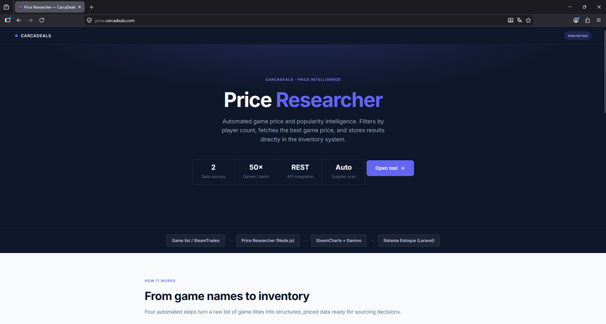

<div align="center">

# Price Researcher

**Automated game price & popularity intelligence for resellers**

[](https://github.com/JoaoVitor2310/price-researcher/actions/workflows/ci.yml)
[](https://github.com/JoaoVitor2310/price-researcher/actions/workflows/deploy.yml)


> **Personal project** built for real production use at **CarcaDeals**, a game key reseller.<br/>
> Replaced a fully manual process, cutting research time from hours to minutes.

**🟢 Live demo → [price.carcadeals.com](https://price.carcadeals.com)**<br/>
<sub>No token required — paste any game names and see the pipeline run (limited to 10 games in demo mode).</sub>



</div>

---

## The Problem

A supplier sends a list of 200+ game titles. The buyer needs to cross-reference each title against marketplaces to decide what's worth purchasing — a process that previously took **hours of manual copy-pasting** across multiple sites, with no signal for whether a game would actually sell.

## The Solution

Price Researcher fully automates that workflow:

1. Receives a list of game names + search criteria (a named preset, popularity tiers by price, minimum price)
2. Fetches the **24h peak player count** from SteamCharts for each game — in parallel batches
3. Filters out games below the popularity threshold (low demand = hard to resell) — cheap games need fewer players than expensive ones. Bundle research reports popularity without filtering, since the supplier sells the whole bundle
4. Filters out known free-to-play titles that have no resale value
5. Scrapes **AllKeyShop** for the best current market price on each qualifying game
6. In authenticated mode, pushes the results directly into the inventory system — zero manual steps

A second async flow accepts a **Steam ID**, crawls the user's trade lists on SteamTrades, extracts game names, and runs the same pipeline automatically.

---

## Business Impact

| Before | After |
|---|---|
| 2–4 hours of manual research per list | ~5 minutes end-to-end |
| Human error in copy-pasting prices | Zero manual steps |
| No popularity signal → bad purchases | Games pre-filtered by real demand data |
| Results copied manually to inventory | Direct integration — results pushed automatically |
| No SteamTrades integration | Full trade list automation via Steam ID |

---

## Two-Mode Design

The API supports two modes controlled by a bearer token:

| | Demo mode | Authenticated mode |
|---|---|---|
| Token | Not provided | Valid `INTERNAL_SECRET` |
| Game limit | 10 | Unlimited |
| Output | JSON returned in the UI | Pushed to inventory system |
| Use case | Try it out | Production pipeline |

This allows the tool to be publicly accessible for demonstration while keeping the full pipeline secure. Auth lives in the controller (presentation layer) — the use case is auth-agnostic and only knows whether a `GameTradeImporter` was injected.

---

## Technical Highlights

- **Clean Architecture** — strict `Domain → Application → Infrastructure → Presentation` layering with port/adapter interfaces for every external dependency, enabling full testability without a real browser or network
- **Anti-bot scraping** — Puppeteer Real Browser + stealth plugin to bypass Cloudflare and similar protections on AllKeyShop and SteamTrades
- **Multi-strategy concurrency** — SteamCharts runs in parallel batches of 50; AllKeyShop is strictly sequential (one browser page); SteamTrades uses a serialized promise gate to avoid rate limits
- **Rate limit resilience** — `fetchWithRetry` honours `Retry-After` headers on HTTP 429 with exponential backoff (3 attempts, 5 s base delay); `gotoWithRetry` handles Puppeteer timeouts the same way
- **Inventory integration** — `HttpGameTradeImporter` implements the `GameTradeImporter` port using native `fetch` with a 15 s `AbortController` timeout, posting structured results to the inventory system over a private bearer-authenticated API
- **Domain-level exclusion list** — `filterExcludedGames` is a pure domain function applied after the popularity filter; free-to-play games are excluded before the price fetcher is ever called
- **Domain-level price floor** — `partitionByPrice` splits off any game whose best price is not above the floor (default €0.50); games that cheap return a few cents of profit and are not worth negotiating; every discarded game is logged with its price, so it never disappears silently between the price fetcher and the result. Applied in one place — `PriceGames` (`application/games/services/price-games.ts`), the pricing engine shared by the search endpoint, the research endpoint, the `lists` flow and supplier discovery — so no consumer repeats the rule. The `research` endpoint can override the floor per request via `minPrice` (bundles send `0`); the floor value is an argument to `partitionByPrice`, so the €0.50 default lives in one place (`MIN_PRICE_EURO`)
- **Price cache** — the AllKeyShop price of each game is kept in Redis for 1 hour (`PRICE_CACHE_TTL_SECONDS`), keyed by normalised name + region + edition, so a game that shows up in several supplier lists is scraped once. Only the raw best price is cached — the preset's "require a Gamivo offer" cut is applied afterwards, in the domain — and only a definitive "not on AllKeyShop" is cached as a miss, never a transient failure. Written game by game as AllKeyShop answers, not at the end of the batch: a research interrupted by a deploy resumes from the cache, re-scraping only what was missing. Fail-open: with Redis down, every read is a miss and the search carries on. See `docs/adr/0008-cache-de-preco-em-redis.md`
- **Durable research queue** — authenticated research is a BullMQ job on the same Redis as the price cache, in database 1 (the cache uses 0), with the server configured as the queue needs it (AOF on, `noeviction`), stored before the `202` is sent. On `SIGTERM` the job in progress goes back to the queue without spending an attempt and runs again on the next boot; a process that dies outright has its job recovered as stalled. Finished jobs are kept as an execution log (7 days completed, 30 days failed). See `docs/adr/0009-fila-duravel-da-pesquisa.md`
- **Signed result webhook** — a caller that sends `webhook_url` is told the outcome (`trade_created` with the Trade uuid, `no_trade`, or `failed` with its kind) once the inventory system answered. The body is signed with HMAC-SHA256 (the secret never travels), only hosts in an allowlist are called (the URL comes from the request, and the service sits inside the internal network), and delivery is a second BullMQ queue retrying for ~24 hours. One result per `request_uuid`. See `docs/adr/0010-webhook-do-resultado-da-pesquisa.md`
- **Async background jobs** — the `lists` and supplier-discovery flows still use `LimitedConcurrencyScheduler`, an in-process queue with configurable concurrency; on completion the Trade is created in the inventory system (there is no callback to the caller)
- **Game name normalisation** — `clear-string.ts` normalises roman numerals, K-suffixed numbers, edition keywords, DLC tags, regional tags and special characters to maximise match accuracy across different naming conventions
- **Full test suite** — unit, integration and contract tests with zero real network or browser calls; integration layer tests the full HTTP pipeline via supertest with vitest mocks at the infrastructure boundary
- **CI/CD** — GitHub Actions runs the full test suite on every pull request; merging to `main` builds the Docker image in CI, publishes it to GHCR (`ghcr.io/joaovitor2310/price-cd`) and triggers a deploy over SSH that only pulls and restarts the container — the VPS never compiles anything

---

## Stack

| Layer | Technology |
|---|---|
| Runtime | Node.js 22 + TypeScript 5 |
| HTTP Server | Nest.js 12 (Express platform) |
| Validation | Zod 4 |
| Scraping | Puppeteer Real Browser + stealth/adblocker plugins |
| HTTP Client | Native fetch (Node.js 22) |
| HTML Parsing | Cheerio |
| Price cache | Redis 7 server (`redis:7.4-alpine`) + `redis` 6 Node client (node-redis; its version line is independent of the server's) — optional, see `REDIS_URL` |
| Research queue | BullMQ 5 + `ioredis`, on the same Redis 7 as the cache (database 1, AOF) — required in production, see `QUEUE_REDIS_URL` |
| Result webhook | `node:crypto` HMAC-SHA256 + native `fetch`; delivery is a second BullMQ queue (`webhooks`) — see `WEBHOOK_ALLOWED_HOSTS` and `WEBHOOK_SIGNING_SECRET` |
| Testing | Vitest + Supertest |
| Linting / Formatting | Biome |
| Containerisation | Docker + Xvfb (headless Chromium in Linux containers) |
| CI/CD | GitHub Actions |

---

## Architecture

```
src/
├── main.ts            # Process entrypoint: boots the Nest container
├── config/            # Zod schema for the environment, validated once at boot
├── nest/              # Presentation + wiring: modules, controllers, filters, pipes
│   ├── common/        #   AllExceptionsFilter, ZodValidationPipe
│   ├── config/        #   ConfigModule with the validated schema
│   ├── games/         #   GamesController and its module
│   ├── lists/         #   ListsController and its module
│   ├── suppliers/     #   SuppliersController and its module
│   ├── bump/          #   BumpScheduler (@Interval + lifecycle hooks)
│   ├── browser/       #   BrowserModule — owns the shared Chromium sessions
│   └── health/        #   Liveness probe
├── schemas/           # Zod schemas + parse helpers
├── application/       # Application layer, one directory per subdomain
│   ├── games/
│   │   ├── use-cases/ #   ResearchGamesUseCase, EnqueueResearchGamesUseCase, RunResearchJobUseCase
│   │   ├── services/  #   PriceGames — the pricing engine shared by every flow; CachedPriceFetcher
│   │   └── ports/     #   PopularityFetcher, PriceFetcher, CatalogPriceSource, PriceCache, GameTradeImporter, TradeWithOfferCreator, ResearchQueue, ResearchResultNotifier
│   ├── lists/         #   RunListsUseCase, EnqueueRunListsUseCase
│   ├── suppliers/     #   FindNewSuppliersUseCase
│   └── bump/          #   BumpTopicsUseCase
├── domain/            # Pure business rules (no Node, no HTTP)
│   ├── games/         #   search presets + popularity tiers, partitionByPrice, filterExcludedGames
│   ├── lists/         #   ListTopic entity
│   └── suppliers/     #   HaveListing parsing
├── infrastructure/    # Concrete adapters implementing port interfaces
│   ├── games/         #   AllKeyShopPriceFetcher, RedisPriceCache, HttpGameTradeImporter, HttpTradeWithOfferCreator
│   ├── background/    #   BullmqResearchQueue (+ its job payload, BullMQ clients, ioredis connections), BullmqWebhookQueue, in-memory versions of both, LimitedConcurrencyScheduler
│   ├── webhooks/      #   HttpWebhookSender, the HMAC signature and the webhook body
│   ├── browser/       #   SharedBrowserSession, SuppliersBrowserSession
│   ├── bump/          #   PuppeteerSteamTradesBumper
│   ├── lists/         #   FetchListTopic (Puppeteer), FormatListResult
│   └── suppliers/     #   Puppeteer paginator, topic scraper, comment poster
├── helpers/           # Pure string-transformation utilities (clear-string.ts)
├── lib/               # Shared infrastructure (Puppeteer factory, process tree, Disposable)
└── types/             # TypeScript type definitions
```

Layer boundary. `test/unit/architecture/layer-boundary.test.ts` enforces the part a test can
check: `domain/`, `application/` and `helpers/` never import `@nestjs/*`; `infrastructure/`
and `lib/` at most `@nestjs/common` (for `@Injectable()`). "Business rules never live in
`nest/`" stays a review rule — no test tells orchestration from a rule.

Ports are `abstract class`es, not interfaces: they survive compilation, so they double as the
injection token without a decorator. The `lists` subdomain declares `ListTopicFetcher`,
`ListTopicFetcherFactory`, `InactiveListNotifier`, `RunListsRunner` and `GameSearcher` — every use case is
testable with zero infrastructure.

---

## Getting Started

**Prerequisites:** Node.js ≥ 22, Docker (optional)

```bash
git clone https://github.com/JoaoVitor2310/price-researcher
cd price-researcher
npm install
cp .env.example .env   # fill in your environment variables
npm run dev
```

**With Docker:**
```bash
docker compose up price-researcher-dev
```

The dev image installs `node_modules` at build time (only `src/` and `public/` are mounted), so after a dependency change rebuild it — otherwise the app crashes at boot with `Cannot find package`:
```bash
docker compose --profile dev up -d --build price-researcher-dev
```

This also starts `redis-dev`, the development Redis: price cache in database 0, research queue in database 1. Production uses its own `redis` service, laid out the same way; dev and production never share one. Outside Docker, leave `REDIS_URL` empty to run without a cache and `QUEUE_REDIS_URL` empty for an in-memory research queue (not allowed in production: the app refuses to boot without it).

**Flush the price cache** — after a deploy that changes the search logic (matching, edition, region), cached prices from the old logic are served for up to 1 hour. To see the new results right away:
```bash
docker compose exec redis redis-cli -n 0 FLUSHDB
```
`-n 0` is the cache database, which is also `redis-cli`'s default — written out so nobody copies the line with `-n 1`. The research queue lives in database 1 of the same Redis: `FLUSHALL`, or `FLUSHDB` with `-n 1`, would delete it.

**Inspect the research queue** — jobs waiting, running, finished and failed (with the reason), kept 7 days when completed and 30 days when failed:
```bash
docker compose exec redis redis-cli -n 1 KEYS 'bull:research:*'
docker compose exec redis redis-cli -n 1 KEYS 'bull:webhooks:*'
```
Never flush database 1: unlike the cache, what is there is a request someone already got a `202` for.

**Run tests:**
```bash
npm test
```

The real-Redis queue tests are opt-in (CI has no Redis). Run them against a throwaway Redis — they `FLUSHDB` the database in the URL:
```bash
docker run -d --rm --name redis-queue-test -p 6390:6379 redis:7.4-alpine
```
```bash
QUEUE_REDIS_TEST_URL=redis://127.0.0.1:6390/15 npx vitest run test/integration/queue
```

---

## API Endpoints

| Method | Path | Description |
|---|---|---|
| `POST` | `/api/games/research` | Research prices for a list of game names — sync preview (demo), async with Trade creation, or sync with results (authenticated) |
| `POST` | `/api/games/research/from-topic` | Async, authenticated: research every game of a SteamTrades topic, create the Trade with an offer and report by webhook |
| `GET` | `/api/games/presets` | List the named search presets: a human `label` plus their criteria |
| `POST` | `/api/games/search-id-steam` | Resolve Steam IDs for a list of games |
| `POST` | `/api/lists/run` | Async: crawl a Steam user's trade lists and run full analysis |
| `POST` | `/api/suppliers/find-new` | Async, queued: scan SteamTrades for new suppliers offering games for TF2 keys, PayPal, euros or dollars |
| `GET` | `/api/health` | Liveness probe, plus the price cache state |

<details>
<summary><strong>POST /api/games/research — request body</strong></summary>

```json
{
  "gameNames": ["Half-Life", "Portal 2", "Hades"],
  "preset": "default",
  "popularity": { "upToThreshold": 30, "aboveThreshold": 100, "priceThresholdEuro": 5 },
  "lookupPopularity": true,
  "minPrice": 0.5,
  "checkGamivoOffer": true,
  "delivery": "trade",
  "internal_secret": "optional-token",
  "steam_id": "optional-supplier-steam-id",
  "list_code": "optional-list-identifier",
  "title": "optional-trade-title",
  "currency": "optional: tf2 | eur | usd",
  "request_uuid": "optional-uuid",
  "webhook_url": "optional-https-url"
}
```

Only `gameNames` (non-empty) is required. Every search criterion comes from a **preset** (`default` when none is sent) and any field sent explicitly overrides it, field by field. Unknown fields are rejected (strict schema).

- `preset` — one of `default`, `bundle-research`, `bundle-sync`, `lists`, `suppliers` (`GET /api/games/presets` lists their values).
- `popularity` — minimum 24h peak players **by price tier**: `upToThreshold` applies to games priced up to `priceThresholdEuro` (inclusive), `aboveThreshold` to pricier ones. Flat popularity is the same value in both. The tiers **only discard**: `0` discards nobody, and a game SteamCharts does not know counts as popularity `0`, so it survives only a tier of `0`.
- `lookupPopularity` — whether SteamCharts is consulted to report each game's popularity; separate from the tiers on purpose. Off, every game comes back with popularity `0`. Any tier above `0` forces it on (without the number every game would be discarded), whatever is sent. `bundle-research` turns it on with tiers `0/0`: the number is reported and nobody is discarded, not even a game SteamCharts does not know. `bundle-sync` keeps it off.
- `minPrice` — games must be priced **above** it (default €0.50); send `0` to keep any priced game.
- `delivery` — only with a valid token: `trade` (default) or `respond`. Ignored without a token, which always gets the demo.

**Demo mode response** — `200`, no token or wrong token:
```json
{
  "success": true,
  "demo": true,
  "games": [
    { "name": "Half-Life", "market_price_euro": 1.23, "popularity": 542, "region": "global" }
  ]
}
```
Runs synchronously and is capped at the first 10 games. Nothing is sent to the inventory system. `market_price_euro` is the market price in euros (the best AllKeyShop price) — not the offer made to a supplier; it is the same name the inventory system receives.

**Authenticated, `delivery: "trade"`** — `202`, valid token:
```json
{ "success": true, "status": "queued" }
```
Returns once the request is stored in the durable queue (ADR 0009). The full list is processed in the background and the Trade is created in the inventory system when it finishes. A restart or deploy in the middle does not lose it: it runs again from the start on the next boot, reading from the price cache what was already priced before the interruption (within the 1-hour TTL), so only the rest goes to AllKeyShop. A failure during background processing is recorded in the job (kept 30 days); a caller that sent `webhook_url` is told the result, failure included (below).

**Trade with an offer and result webhook** — `202`, valid token. Three more fields, sent together by callers that want to be told the outcome (the chatbot, ADR 0010):

```json
{
  "gameNames": ["Rust ROW", "Hades"],
  "internal_secret": "token",
  "steam_id": "76561198012345678",
  "currency": "eur",
  "request_uuid": "8c1f6a2e-3b4d-4c5e-9f00-1a2b3c4d5e6f",
  "webhook_url": "https://chatbot.example.com/webhooks/price-cd"
}
```

- `currency` — `tf2`, `eur` or `usd`, the currency the supplier chose. With it, the Trade is created **with an offer** in the inventory system's `POST /api/trades` (the inventory system decides the offer); without it, the usual Trade without an offer (`/trades/from-price-researcher`). Requires `steam_id` as a SteamID64 (17 digits starting with `7656119`).
- `request_uuid` — the caller's id for the request. The same uuid sent again is recognized: still queued or running → nothing happens (it will report); completed → its stored result is delivered again, without researching again; failed → it runs again from scratch.
- `webhook_url` — where to send the result. Requires `request_uuid` and `currency`. Its host must be listed in `WEBHOOK_ALLOWED_HOSTS` (exact host match, any port).

These fields return **`400`** — in the route's `data` format, `"Invalid file content: ..."` — when:

| Case | Message |
|---|---|
| sent without a valid token (not demo: whoever sends them expects a Trade and a webhook) | `currency, request_uuid and webhook_url require a valid internal_secret` |
| `currency` without a SteamID64 `steam_id` | `currency requires steam_id as a SteamID64` |
| `webhook_url` without `request_uuid` / `currency` | `webhook_url requires request_uuid` / `webhook_url requires currency` |
| `webhook_url` host not in `WEBHOOK_ALLOWED_HOSTS` | `webhook_url host is not allowed` |
| with `delivery: "respond"` | `delivery "respond" does not accept currency, request_uuid or webhook_url` |

Without these fields the route behaves exactly as before.

<details>
<summary><strong>Result webhook — what the price researcher sends</strong></summary>

Sent once the request finishes, **after** the inventory system answered: with `trade_created`, the Trade already exists.

```http
POST {webhook_url}
Content-Type: application/json
X-Webhook-Timestamp: 1762268400
X-Webhook-Signature: sha256=<64 hex chars>
```
```json
{ "request_uuid": "8c1f…", "result": "trade_created", "trade_uuid": "3a9e…" }
{ "request_uuid": "8c1f…", "result": "no_trade" }
{ "request_uuid": "8c1f…", "result": "failed", "failure": { "kind": "stock_unavailable", "message": "Sistema Estoque could not create the Trade right now." } }
```

| `result` | When |
|---|---|
| `trade_created` | The inventory system created the Trade (`201`); `trade_uuid` is its uuid |
| `no_trade` | No game passed the filters (the inventory system is not even called), it had nothing to offer (`200 { created: false }`), or, on `/from-topic`, the topic shows no priceable game. Never sent when a game could not be looked up and nothing passed: that is `failed` |
| `failed` | `failure.kind` is `scrape_failed` (only on `/from-topic`: the topic could not be read — retrying later may work), `pricing_failed` (the research itself failed, including a job that kept crashing the process or could not be read, no game passed while at least one could not be looked up, the inventory system rejected the request with `422`, or it answered `201` without a readable uuid — do not retry blindly: in that last case the Trade exists), or `stock_unavailable` (the inventory system could not answer: `503`, timeout, any other error — retrying later may work) |

When only some games cannot be looked up, the Trade is created with the ones that could, and the rest are logged.

`failure.message` is a fixed sentence per `kind`, never the internal error; the details stay in the price researcher's logs and job record. No market price, popularity or margin is ever sent.

**Signature.** `X-Webhook-Signature` is `sha256=` + the hex HMAC-SHA256 of `"<X-Webhook-Timestamp>.<raw body>"`, keyed with `WEBHOOK_SIGNING_SECRET`, which the receiver holds too — the secret itself is never sent. To verify, the receiver must hash the **raw bytes** it received (before any JSON parsing), compare in constant time, and reject timestamps older than 5 minutes (replay):

```ts
import { createHmac, timingSafeEqual } from "node:crypto";

function isValid(rawBody: string, timestamp: string, signature: string, secret: string): boolean {
  const sentAt = Number(timestamp);
  if (!Number.isFinite(sentAt) || Math.abs(Date.now() / 1000 - sentAt) > 300) return false;
  const expected = `sha256=${createHmac("sha256", secret).update(`${timestamp}.${rawBody}`).digest("hex")}`;
  return expected.length === signature.length && timingSafeEqual(Buffer.from(expected), Buffer.from(signature));
}
```

**Delivery.** Only a `2xx` counts as delivered; anything else — including a redirect, which is never followed — is retried: 30 s, doubling up to 1 h, for about 24 hours (31 attempts), then given up and recorded. The receiver must be idempotent by `request_uuid`: a retry may arrive after a timeout that the receiver did process. One result per `request_uuid`: a later result for the same request never replaces a delivered one, except after a failed request is sent again.

Without `QUEUE_REDIS_URL` (outside production only) the webhook is attempted once, not retried.

</details>

**Authenticated, queue unavailable** — `500`, when the queue Redis is configured but not answering. The request is refused instead of accepted without being stored; `GET /api/health` shows `queue: "down"`. The body is the route's legacy error format:
```json
{ "success": false, "error": "Internal server error.", "details": "Research queue unavailable: Redis is not connected" }
```

**Authenticated, `delivery: "respond"`** — `200`, valid token:
```json
{
  "success": true,
  "games": [
    { "name": "Half-Life", "market_price_euro": 1.23, "popularity": 542, "region": "global", "id_steam": "70", "gamivo_id": null }
  ]
}
```
Runs synchronously over the whole list and creates no Trade. Exists for callers that store the prices themselves, like the hourly bundle sync. No `demo` field.

</details>

<details>
<summary><strong>POST /api/games/research/from-topic — request body</strong></summary>

Research from a supplier's SteamTrades topic instead of a typed list. The whole `.have` section is researched, with no limit on the number of games, using the `lists` preset. The topic code becomes the Trade's `list_code`. Who owns the topic is not checked, and a closed topic is researched too: the supplier sent the link. Non-Steam sections (`GOG:` and the like) are skipped, as in every flow that reads `.have`.

```json
{
  "topic_url": "https://www.steamtrades.com/trade/wGVYD/h-games-w-tf2",
  "steam_id": "76561198012345678",
  "currency": "tf2",
  "request_uuid": "8c1f6a2e-3b4d-4c5e-9f00-1a2b3c4d5e6f",
  "webhook_url": "https://chatbot.example.com/webhooks/price-cd",
  "internal_secret": "token"
}
```

All fields are required. `currency`, `request_uuid` and `webhook_url` work as in `POST /api/games/research`, including what happens when the same `request_uuid` is sent again; the result arrives by the same webhook (see "Result webhook" above).

| Status | Body | When |
|---|---|---|
| `202` | `{ "success": true, "status": "queued" }` | Stored in the durable queue. The topic is read when the job runs, so a scrape failure arrives as `failed` with `kind: scrape_failed` |
| `400` | `{ "success": false, "error": "Validation failed", "details": "..." }` | Invalid body, `topic_url` that is not `https://www.steamtrades.com/trade/{code}/...`, `steam_id` that is not a SteamID64, or `webhook_url` host not in `WEBHOOK_ALLOWED_HOSTS` |
| `401` | `{ "success": false, "error": "Invalid internal_secret" }` | Missing or wrong token, checked before the body. This route has no demo mode |
| `500` | `{ "success": false, "error": "Internal server error.", "details": "..." }` | The request could not be stored (queue down) |

</details>

<details>
<summary><strong>POST /api/lists/run — request body</strong></summary>

```json
{
  "steam_id": "76561198000000000",
  "checkGamivoOffer": true
}
```

`steam_id` is required; `checkGamivoOffer` defaults to `true`. Unknown fields are rejected (strict schema).

Returns `202 Accepted` immediately:

```json
{ "success": true, "status": "queued" }
```

The crawl and pricing run in the background and the Trade is created in the inventory system when they finish. There is **no callback** to the caller, and a failure during background processing is currently only logged — see `docs/IMPROVEMENTS.md`.

</details>

<details>
<summary><strong>POST /api/suppliers/find-new</strong></summary>

No request body. Requires `STEAMTRADES_SESSION`, `SISTEMA_ESTOQUE_URL` and `EXTERNAL_SECRET` to be configured on the server.

**Response** — `202`:
```json
{ "success": true, "status": "queued" }
```
Returns as soon as the scan is queued — scanning up to 100 SteamTrades pages per search term — the TF2 variants plus `paypal`, `pp`, `euro`, `dollar`, `dolar`, `usdt`, `€` and `$` (the listing search is already filtered server-side) and researching prices per topic can take minutes. Runs in the background; eligible suppliers are commented on directly on SteamTrades once the Sistema Estoque approves. The comment states the offer in the list's offer currency — TF2 keys, else dollars, else euros (PayPal counts as euros) — and the Sistema Estoque is the one that computes and converts it. A failure during background processing is currently only logged.

**Response** — `500`, when required env vars are missing:
```json
{ "error": "<missing env var message>" }
```

</details>

<details>
<summary><strong>GET /api/health</strong></summary>

**Response** — `200`:
```json
{ "status": "ok", "app": "nest", "env": "production", "cache": "up", "queue": "up" }
```
`cache` is the price cache state: `up`, `down` (Redis configured but not answering) or `disabled` (no `REDIS_URL`). The response stays `200` when the cache is down — the app still searches, only slower — so a container healthcheck never restarts the app because of Redis. An external monitor that wants to know about a Redis outage should check this field.

`queue` is the research queue state: `up`, `down` (queue Redis configured but not answering — authenticated research is refused with `500`) or `in-memory` (no `QUEUE_REDIS_URL`; only possible outside production). It does not change the `200` either: demo, `respond`, `lists` and supplier discovery keep working.

</details>

---

<div align="center">

Built by [João Vitor Gouveia](https://www.linkedin.com/in/jo%C3%A3o-vitor-matos-gouveia-14b71437/) · Personal project · Production use at CarcaDeals

</div>
