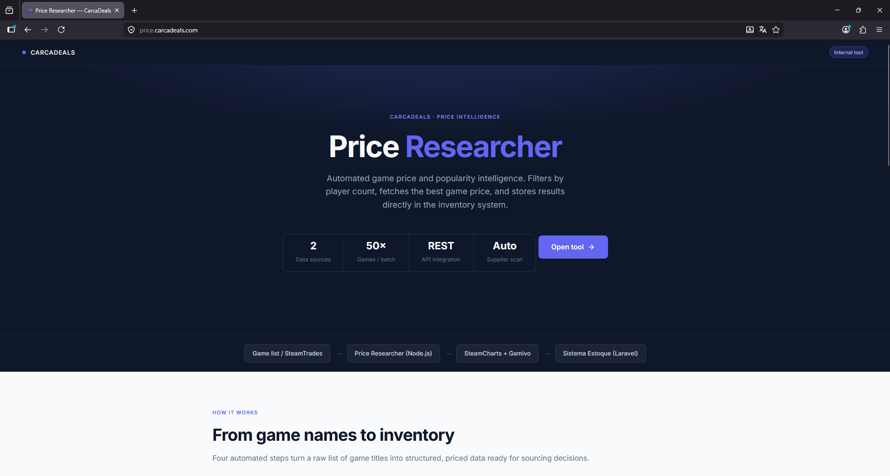

<div align="center">

# Price Researcher

**Automated game price & popularity intelligence for resellers**

[](https://github.com/JoaoVitor2310/price-researcher/actions/workflows/ci.yml)
[](https://github.com/JoaoVitor2310/price-researcher/actions/workflows/deploy.yml)


> **Personal project** built for real production use at **CarcaDeals**, a game key reseller.<br/>
> Replaced a fully manual process, cutting research time from hours to minutes.

**🟢 Live demo → [price.carcadeals.com](https://price.carcadeals.com)**<br/>
<sub>No token required — paste any game names and see the pipeline run (limited to 10 games in demo mode).</sub>



</div>

---

## The Problem

A supplier sends a list of 200+ game titles. The buyer needs to cross-reference each title against marketplaces to decide what's worth purchasing — a process that previously took **hours of manual copy-pasting** across multiple sites, with no signal for whether a game would actually sell.

## The Solution

Price Researcher fully automates that workflow:

1. Receives a list of game names + search criteria (a named preset, popularity tiers by price, minimum price)
2. Fetches the **24h peak player count** from SteamCharts for each game — in parallel batches
3. Filters out games below the popularity threshold (low demand = hard to resell) — cheap games need fewer players than expensive ones. Bundle research reports popularity without filtering, since the supplier sells the whole bundle
4. Filters out known free-to-play titles that have no resale value
5. Scrapes **AllKeyShop** for the best current market price on each qualifying game
6. In authenticated mode, pushes the results directly into the inventory system — zero manual steps

A second async flow accepts a **Steam ID**, crawls the user's trade lists on SteamTrades, extracts game names, and runs the same pipeline automatically.

---

## Business Impact

| Before | After |
|---|---|
| 2–4 hours of manual research per list | ~5 minutes end-to-end |
| Human error in copy-pasting prices | Zero manual steps |
| No popularity signal → bad purchases | Games pre-filtered by real demand data |
| Results copied manually to inventory | Direct integration — results pushed automatically |
| No SteamTrades integration | Full trade list automation via Steam ID |

---

## Two-Mode Design

The API supports two modes controlled by a bearer token:

| | Demo mode | Authenticated mode |
|---|---|---|
| Token | Not provided | Valid `INTERNAL_SECRET` |
| Game limit | 10 | Unlimited |
| Output | JSON returned in the UI | Pushed to inventory system |
| Use case | Try it out | Production pipeline |

This allows the tool to be publicly accessible for demonstration while keeping the full pipeline secure. Auth lives in the controller (presentation layer) — the use case is auth-agnostic and only knows whether a `GameTradeImporter` was injected.

---

## Technical Highlights

- **Clean Architecture** — strict `Domain → Application → Infrastructure → Presentation` layering with port/adapter interfaces for every external dependency, enabling full testability without a real browser or network
- **Anti-bot scraping** — Puppeteer Real Browser + stealth plugin to bypass Cloudflare and similar protections on AllKeyShop and SteamTrades
- **Multi-strategy concurrency** — SteamCharts runs in parallel batches of 50; AllKeyShop is strictly sequential (one browser page); SteamTrades uses a serialized promise gate to avoid rate limits
- **Rate limit resilience** — `fetchWithRetry` honours `Retry-After` headers on HTTP 429 with exponential backoff (3 attempts, 5 s base delay); `gotoWithRetry` handles Puppeteer timeouts the same way
- **Inventory integration** — `HttpGameTradeImporter` implements the `GameTradeImporter` port using native `fetch` with a 15 s `AbortController` timeout, posting structured results to the inventory system over a private bearer-authenticated API
- **Domain-level exclusion list** — `filterExcludedGames` is a pure domain function applied after the popularity filter; free-to-play games are excluded before the price fetcher is ever called
- **Domain-level price floor** — `partitionByPrice` splits off any game whose best price is not above the floor (default €0.50); games that cheap return a few cents of profit and are not worth negotiating; every discarded game is logged with its price, so it never disappears silently between the price fetcher and the result. Applied in one place — `PriceGames` (`application/games/services/price-games.ts`), the pricing engine shared by the search endpoint, the research endpoint, the `lists` flow and supplier discovery — so no consumer repeats the rule. The `research` endpoint can override the floor per request via `minPrice` (bundles send `0`); the floor value is an argument to `partitionByPrice`, so the €0.50 default lives in one place (`MIN_PRICE_EURO`)
- **Price cache** — the AllKeyShop price of each game is kept in Redis for 1 hour (`PRICE_CACHE_TTL_SECONDS`), keyed by normalised name + region + edition, so a game that shows up in several supplier lists is scraped once. Only the raw best price is cached — the preset's "require a Gamivo offer" cut is applied afterwards, in the domain — and only a definitive "not on AllKeyShop" is cached as a miss, never a transient failure. Fail-open: with Redis down, every read is a miss and the search carries on. See `docs/adr/0008-cache-de-preco-em-redis.md`
- **Async background jobs** — `LimitedConcurrencyScheduler` queues list-processing jobs in-process with configurable concurrency; on completion the Trade is created in the inventory system (there is no callback to the caller)
- **Game name normalisation** — `clear-string.ts` normalises roman numerals, K-suffixed numbers, edition keywords, DLC tags, regional tags and special characters to maximise match accuracy across different naming conventions
- **Full test suite** — 159 tests (unit + integration) with zero real network or browser calls; integration layer tests the full HTTP pipeline via supertest with vitest mocks at the infrastructure boundary
- **CI/CD** — GitHub Actions runs the full test suite on every pull request; merging to `main` builds the Docker image in CI, publishes it to GHCR (`ghcr.io/joaovitor2310/price-cd`) and triggers a deploy over SSH that only pulls and restarts the container — the VPS never compiles anything

---

## Stack

| Layer | Technology |
|---|---|
| Runtime | Node.js 22 + TypeScript 5 |
| HTTP Server | Nest.js 12 (Express platform) |
| Validation | Zod 4 |
| Scraping | Puppeteer Real Browser + stealth/adblocker plugins |
| HTTP Client | Native fetch (Node.js 22) |
| HTML Parsing | Cheerio |
| Price cache | Redis 7 server (`redis:7.4-alpine`) + `redis` 6 Node client (node-redis; its version line is independent of the server's) — optional, see `REDIS_URL` |
| Testing | Vitest + Supertest |
| Linting / Formatting | Biome |
| Containerisation | Docker + Xvfb (headless Chromium in Linux containers) |
| CI/CD | GitHub Actions |

---

## Architecture

```
src/
├── main.ts            # Process entrypoint: boots the Nest container
├── config/            # Zod schema for the environment, validated once at boot
├── nest/              # Presentation + wiring: modules, controllers, filters, pipes
│   ├── common/        #   AllExceptionsFilter, ZodValidationPipe
│   ├── config/        #   ConfigModule with the validated schema
│   ├── games/         #   GamesController and its module
│   ├── lists/         #   ListsController and its module
│   ├── suppliers/     #   SuppliersController and its module
│   ├── bump/          #   BumpScheduler (@Interval + lifecycle hooks)
│   ├── browser/       #   BrowserModule — owns the shared Chromium sessions
│   └── health/        #   Liveness probe
├── schemas/           # Zod schemas + parse helpers
├── application/       # Application layer, one directory per subdomain
│   ├── games/
│   │   ├── use-cases/ #   ResearchGamesUseCase, EnqueueResearchGamesUseCase
│   │   ├── services/  #   PriceGames — the pricing engine shared by every flow; CachedPriceFetcher
│   │   └── ports/     #   PopularityFetcher, PriceFetcher, CatalogPriceSource, PriceCache, GameTradeImporter
│   ├── lists/         #   RunListsUseCase, EnqueueRunListsUseCase
│   ├── suppliers/     #   FindNewSuppliersUseCase
│   └── bump/          #   BumpTopicsUseCase
├── domain/            # Pure business rules (no Node, no HTTP)
│   ├── games/         #   search presets + popularity tiers, partitionByPrice, filterExcludedGames
│   ├── lists/         #   ListTopic entity
│   └── suppliers/     #   HaveListing parsing
├── infrastructure/    # Concrete adapters implementing port interfaces
│   ├── games/         #   AllKeyShopPriceFetcher, RedisPriceCache, HttpGameTradeImporter
│   ├── background/    #   LimitedConcurrencyScheduler
│   ├── browser/       #   SharedBrowserSession, SuppliersBrowserSession
│   ├── bump/          #   PuppeteerSteamTradesBumper
│   ├── lists/         #   FetchListTopic (Puppeteer), FormatListResult
│   └── suppliers/     #   Puppeteer paginator, topic scraper, comment poster
├── helpers/           # Pure string-transformation utilities (clear-string.ts)
├── lib/               # Shared infrastructure (Puppeteer factory, process tree, Disposable)
└── types/             # TypeScript type definitions
```

Layer boundary. `test/unit/architecture/layer-boundary.test.ts` enforces the part a test can
check: `domain/`, `application/` and `helpers/` never import `@nestjs/*`; `infrastructure/`
and `lib/` at most `@nestjs/common` (for `@Injectable()`). "Business rules never live in
`nest/`" stays a review rule — no test tells orchestration from a rule.

Ports are `abstract class`es, not interfaces: they survive compilation, so they double as the
injection token without a decorator. The `lists` subdomain declares `ListTopicFetcher`,
`ListTopicFetcherFactory`, `InactiveListNotifier`, `RunListsRunner` and `GameSearcher` — every use case is
testable with zero infrastructure.

---

## Getting Started

**Prerequisites:** Node.js ≥ 22, Docker (optional)

```bash
git clone https://github.com/JoaoVitor2310/price-researcher
cd price-researcher
npm install
cp .env.example .env   # fill in your environment variables
npm run dev
```

**With Docker:**
```bash
docker compose up price-researcher-dev
```

This also starts `redis-dev`, the development price cache. Production uses its own `redis` service; the two never share a cache. Outside Docker, leave `REDIS_URL` empty to run without a cache.

**Flush the price cache** — after a deploy that changes the search logic (matching, edition, region), cached prices from the old logic are served for up to 1 hour. To see the new results right away:
```bash
docker compose exec redis redis-cli FLUSHDB
```

**Run tests:**
```bash
npm test
```

---

## API Endpoints

| Method | Path | Description |
|---|---|---|
| `POST` | `/api/games/research` | Research prices for a list of game names — sync preview (demo), async with Trade creation, or sync with results (authenticated) |
| `GET` | `/api/games/presets` | List the named search presets: a human `label` plus their criteria |
| `POST` | `/api/games/search-id-steam` | Resolve Steam IDs for a list of games |
| `POST` | `/api/lists/run` | Async: crawl a Steam user's trade lists and run full analysis |
| `POST` | `/api/suppliers/find-new` | Async, queued: scan SteamTrades for new suppliers offering games for TF2 keys, PayPal, euros or dollars |
| `GET` | `/api/health` | Liveness probe, plus the price cache state |

<details>
<summary><strong>POST /api/games/research — request body</strong></summary>

```json
{
  "gameNames": ["Half-Life", "Portal 2", "Hades"],
  "preset": "default",
  "popularity": { "upToThreshold": 30, "aboveThreshold": 100, "priceThresholdEuro": 5 },
  "lookupPopularity": true,
  "minPrice": 0.5,
  "checkGamivoOffer": true,
  "delivery": "trade",
  "internal_secret": "optional-token",
  "steam_id": "optional-supplier-steam-id",
  "list_code": "optional-list-identifier",
  "title": "optional-trade-title"
}
```

Only `gameNames` (non-empty) is required. Every search criterion comes from a **preset** (`default` when none is sent) and any field sent explicitly overrides it, field by field. Unknown fields are rejected (strict schema).

- `preset` — one of `default`, `bundle-research`, `bundle-sync`, `lists`, `suppliers` (`GET /api/games/presets` lists their values).
- `popularity` — minimum 24h peak players **by price tier**: `upToThreshold` applies to games priced up to `priceThresholdEuro` (inclusive), `aboveThreshold` to pricier ones. Flat popularity is the same value in both. The tiers **only discard**: `0` discards nobody, and a game SteamCharts does not know counts as popularity `0`, so it survives only a tier of `0`.
- `lookupPopularity` — whether SteamCharts is consulted to report each game's popularity; separate from the tiers on purpose. Off, every game comes back with popularity `0`. Any tier above `0` forces it on (without the number every game would be discarded), whatever is sent. `bundle-research` turns it on with tiers `0/0`: the number is reported and nobody is discarded, not even a game SteamCharts does not know. `bundle-sync` keeps it off.
- `minPrice` — games must be priced **above** it (default €0.50); send `0` to keep any priced game.
- `delivery` — only with a valid token: `trade` (default) or `respond`. Ignored without a token, which always gets the demo.

**Demo mode response** — `200`, no token or wrong token:
```json
{
  "success": true,
  "demo": true,
  "games": [
    { "name": "Half-Life", "market_price_euro": 1.23, "popularity": 542, "region": "global" }
  ]
}
```
Runs synchronously and is capped at the first 10 games. Nothing is sent to the inventory system. `market_price_euro` is the market price in euros (the best AllKeyShop price) — not the offer made to a supplier; it is the same name the inventory system receives.

**Authenticated, `delivery: "trade"`** — `202`, valid token:
```json
{ "success": true, "status": "queued" }
```
Returns as soon as the work is queued. The full list is processed in the background and the Trade is created in the inventory system when it finishes. A failure during background processing is currently only logged — see `docs/IMPROVEMENTS.md`.

**Authenticated, `delivery: "respond"`** — `200`, valid token:
```json
{
  "success": true,
  "games": [
    { "name": "Half-Life", "market_price_euro": 1.23, "popularity": 542, "region": "global", "id_steam": "70", "gamivo_id": null }
  ]
}
```
Runs synchronously over the whole list and creates no Trade. Exists for callers that store the prices themselves, like the hourly bundle sync. No `demo` field.

</details>

<details>
<summary><strong>POST /api/lists/run — request body</strong></summary>

```json
{
  "steam_id": "76561198000000000",
  "checkGamivoOffer": true
}
```

`steam_id` is required; `checkGamivoOffer` defaults to `true`. Unknown fields are rejected (strict schema).

Returns `202 Accepted` immediately:

```json
{ "success": true, "status": "queued" }
```

The crawl and pricing run in the background and the Trade is created in the inventory system when they finish. There is **no callback** to the caller, and a failure during background processing is currently only logged — see `docs/IMPROVEMENTS.md`.

</details>

<details>
<summary><strong>POST /api/suppliers/find-new</strong></summary>

No request body. Requires `STEAMTRADES_SESSION`, `SISTEMA_ESTOQUE_URL` and `EXTERNAL_SECRET` to be configured on the server.

**Response** — `202`:
```json
{ "success": true, "status": "queued" }
```
Returns as soon as the scan is queued — scanning up to 100 SteamTrades pages per search term — the TF2 variants plus `paypal`, `pp`, `euro`, `dollar`, `dolar`, `usdt`, `€` and `$` (the listing search is already filtered server-side) and researching prices per topic can take minutes. Runs in the background; eligible suppliers are commented on directly on SteamTrades once the Sistema Estoque approves. The comment states the offer in the list's offer currency — TF2 keys, else dollars, else euros (PayPal counts as euros) — and the Sistema Estoque is the one that computes and converts it. A failure during background processing is currently only logged.

**Response** — `500`, when required env vars are missing:
```json
{ "error": "<missing env var message>" }
```

</details>

<details>
<summary><strong>GET /api/health</strong></summary>

**Response** — `200`:
```json
{ "status": "ok", "app": "nest", "env": "production", "cache": "up" }
```
`cache` is the price cache state: `up`, `down` (Redis configured but not answering) or `disabled` (no `REDIS_URL`). The response stays `200` when the cache is down — the app still searches, only slower — so a container healthcheck never restarts the app because of Redis. An external monitor that wants to know about a Redis outage should check this field.

</details>

---

<div align="center">

Built by [João Vitor Gouveia](https://www.linkedin.com/in/jo%C3%A3o-vitor-matos-gouveia-14b71437/) · Personal project · Production use at CarcaDeals

</div>
